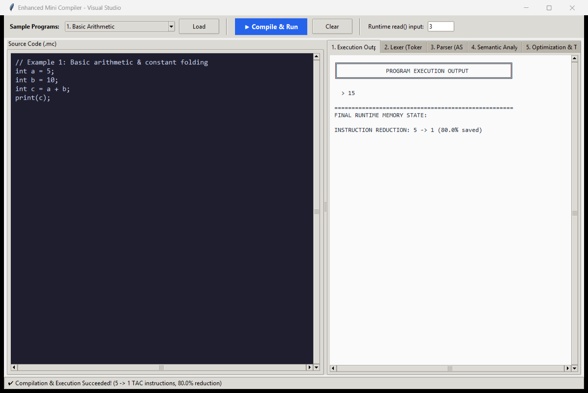

# Enhanced Mini Compiler with TAC Optimization 

An educational compiler implemented in Python following the research architecture of **Singh & Kulkarni (IJIRT 2026)**, with enhanced extensions including **Common Subexpression Elimination (CSE)**, **Strength Reduction**, and an **Interactive Visual Studio GUI**.

---

## 📸 



*The visual UI provides a side-by-side workspace: write source code on the left, and inspect every compilation phase (Tokens, AST, Symbol Table, TAC Optimization comparison, and Output) on the right.*

---

## 🌟 Key Features

1. **Full Multi-Phase Pipeline**:
   - **Lexer**: Tokenization via regular expressions with source coordinate tracking.
   - **Parser**: Recursive-descent parser producing a structured Abstract Syntax Tree (AST).
   - **Semantic Analyzer**: Symbol table validation, type checking, duplicate detection, and compile-time division-by-zero checks.
   - **TAC Generator**: Lowers the AST into Three-Address Code quadruples `(op, arg1, arg2, result)`.
   - **Optimizer**: Multi-pass intermediate code optimizer.
   - **Interpreter**: Simulated RAM-based execution environment.

2. **Advanced Multi-Pass TAC Optimization**:
   - **Constant Folding**: Evaluates constant expressions at compile time ($5 + 10 \rightarrow 15$).
   - **Constant & Copy Propagation**: Substitutes known literal values and variable aliases.
   - **Common Subexpression Elimination (CSE)**: Reuses previously computed values instead of duplicating operations.
   - **Strength Reduction**: Converts expensive multiplications by powers of two into efficient bitwise left shifts ($x \times 8 \rightarrow x \ll 3$).
   - **Dead Code Elimination (DCE)**: Prunes assignments and temporaries that are never used.

3. **Benchmarked Instruction Reductions**:
   - Achieves between **37.5% and 91.7%** instruction reductions across test programs without altering semantics.

4. **Visual Studio IDE Interface**:
   - Built with Python's standard `tkinter` (zero external dependencies).
   - Built-in sample program loader (`basic.mc`, `optimization.mc`, `string.mc`, `advanced_optimization.mc`).
   - Real-time visual comparison of **Before vs. After TAC** and optimization statistics.

---

## 📂 Project Structure

```
Compiler_Design/
│
├── docs/
│   └── ui_screenshot.png           # UI preview screenshot
│
├── Enhanced_Mini_Compiler/
│   ├── main.py                     # CLI pipeline driver
│   ├── ui.py                       # Interactive Tkinter GUI
│   │
│   ├── src/
│   │   ├── ast_nodes.py            # AST node definitions
│   │   ├── lexer.py                # Regex-based tokenizer
│   │   ├── parser.py               # Recursive descent parser
│   │   ├── semantic.py             # Type & symbol table checker
│   │   ├── tac.py                  # Three-Address Code generator
│   │   ├── optimizer.py            # 4-pass TAC optimization engine
│   │   └── interpreter.py          # TAC runtime interpreter
│   │
│   ├── examples/
│   │   ├── basic.mc                # Basic arithmetic & folding
│   │   ├── optimization.mc         # Constant folding & dead code
│   │   ├── string.mc               # String concatenation & propagation
│   │   └── advanced_optimization.mc # read(), CSE & strength reduction
│   │
│   └── tests/
│       └── test_compiler.py        # Automated unit tests
│
├── IJIRT205683_PAPER.pdf           # Reference research paper
├── README.md                       # Documentation
└── .gitignore
```

---

## 🚀 Getting Started

### Prerequisites
- **Python 3.9+** (No external packages required).

---

### Running the Visual GUI (Recommended)

To launch the graphical visualizer:

```powershell
cd Enhanced_Mini_Compiler
python ui.py
```

- Select an example from the dropdown and click **Load**.
- Click **▶ Compile & Run** to execute the pipeline.
- Switch between tabs to see **Execution Output**, **Tokens**, **AST**, **Symbol Table**, and **Optimization & TAC**.

---

### Running via Command Line (CLI)

Navigate to the project directory:
```powershell
cd Enhanced_Mini_Compiler
```

#### 1. Run Basic Program
```powershell
python main.py examples/basic.mc
```

#### 2. Run Optimization Showcase
```powershell
python main.py examples/optimization.mc
```

#### 3. Run String Operations
```powershell
python main.py examples/string.mc
```

#### 4. Run Interactive Input Program (CSE & Strength Reduction)
```powershell
python main.py examples/advanced_optimization.mc
```
*(Enter `3` when prompted for `x`)*

---

### Running Automated Tests

Run the test suite to verify constant folding, string operations, CSE, strength reduction, and semantic error detection:

```powershell
cd Enhanced_Mini_Compiler
python -m unittest discover -s tests -v
```

---

## 📊 Optimization Results Summary

| Program | Optimization Focus | Before TAC | After TAC | Reduction (%) | Output |
|---|---|:---:|:---:|:---:|---|
| `basic.mc` | Constant Folding & Propagation | 5 | 1 | **80.0%** | `15` |
| `optimization.mc` | Constant Folding & Dead Code Pruning | 12 | 1 | **91.7%** | `94` |
| `string.mc` | String Propagation & Concatenation | 5 | 3 | **40.0%** | `Hello Compiler` |
| `advanced_optimization.mc` | Runtime `read()`, CSE & Bit-Shift (`<<`) | 8 | 5 | **37.5%** | `48` (for $x=3$) |

---

## 📜 Research Paper Reference

This project is built upon and extends:
> **Vinita Singh & Omkar Kulkarni**, *"Design and Implementation of a Mini Compiler with Three Address Code Generation, Optimization, and Interpreter-Based Execution"*, **IJIRT**, Volume 13, Issue 1, June 2026.

